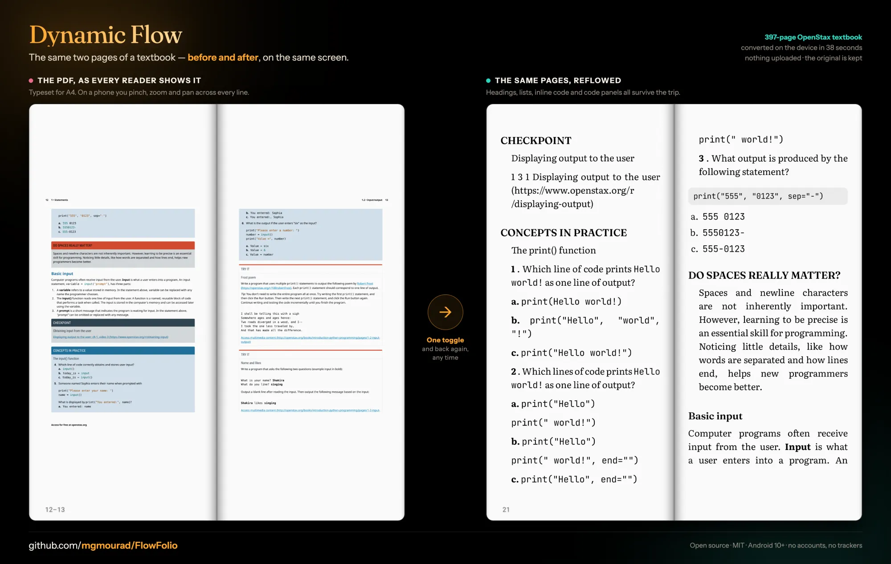
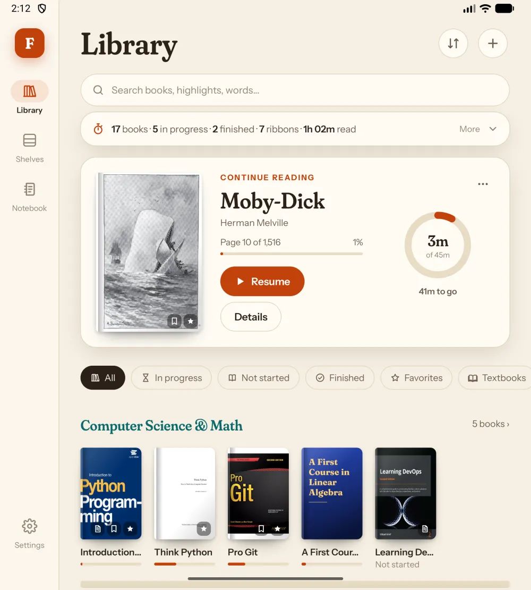
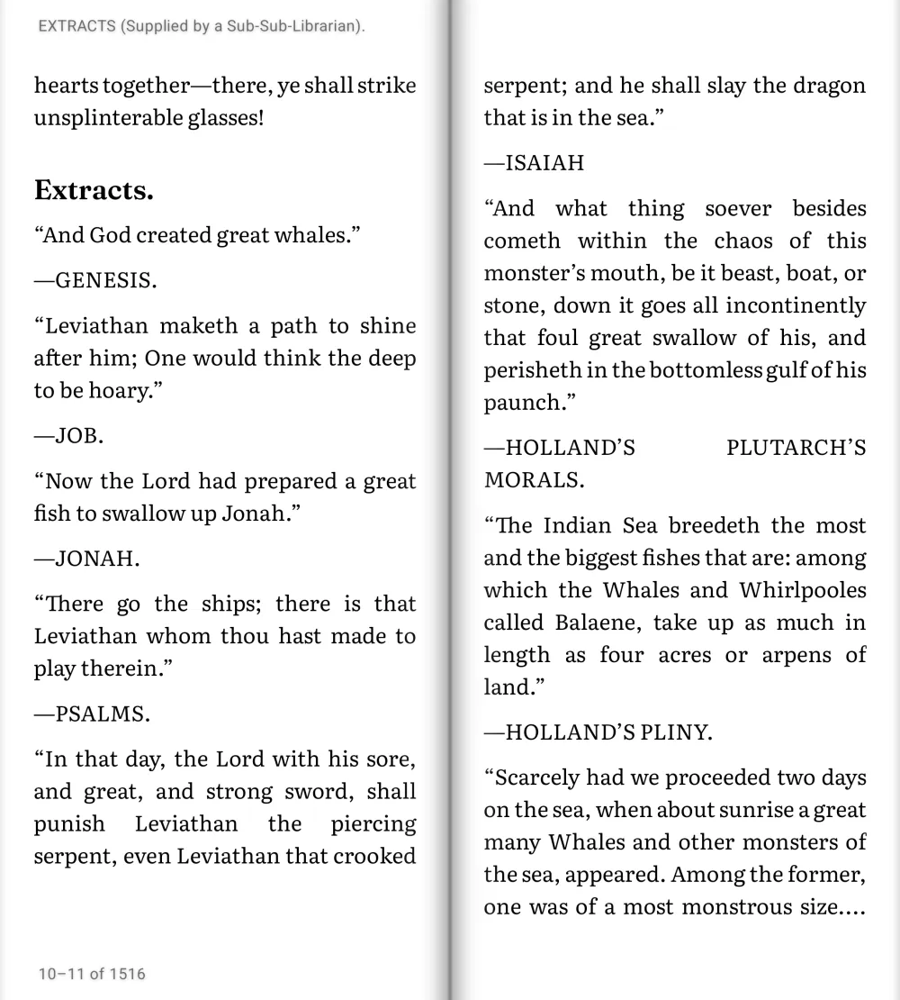
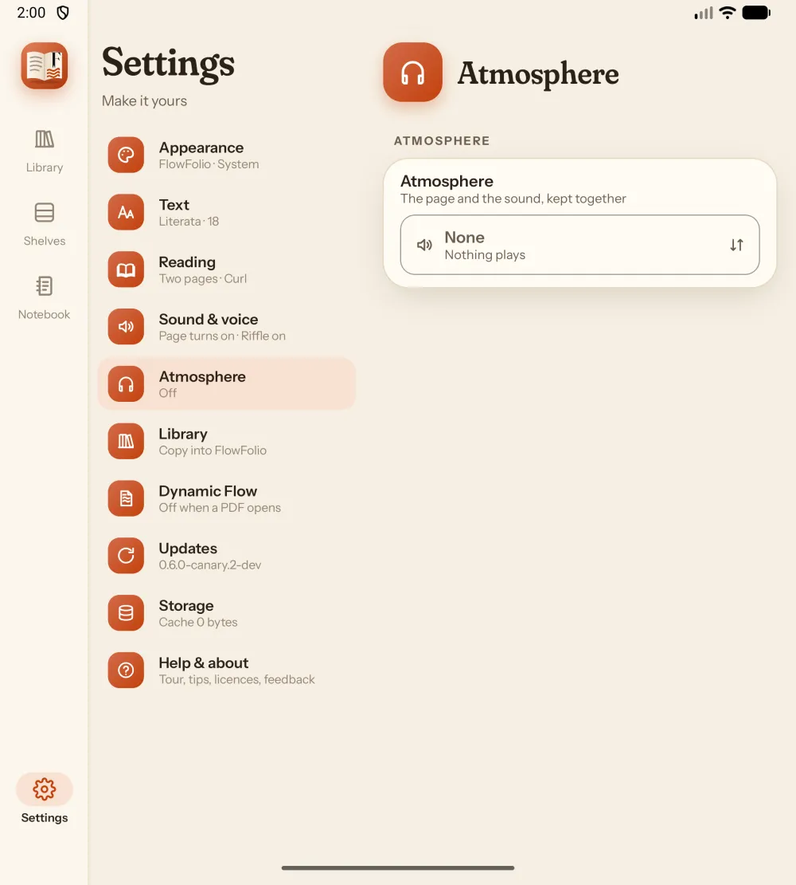
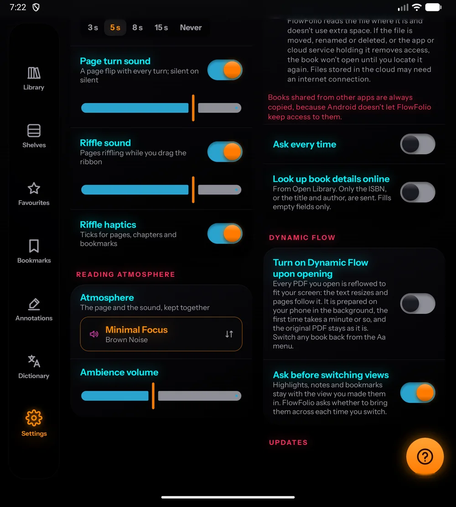
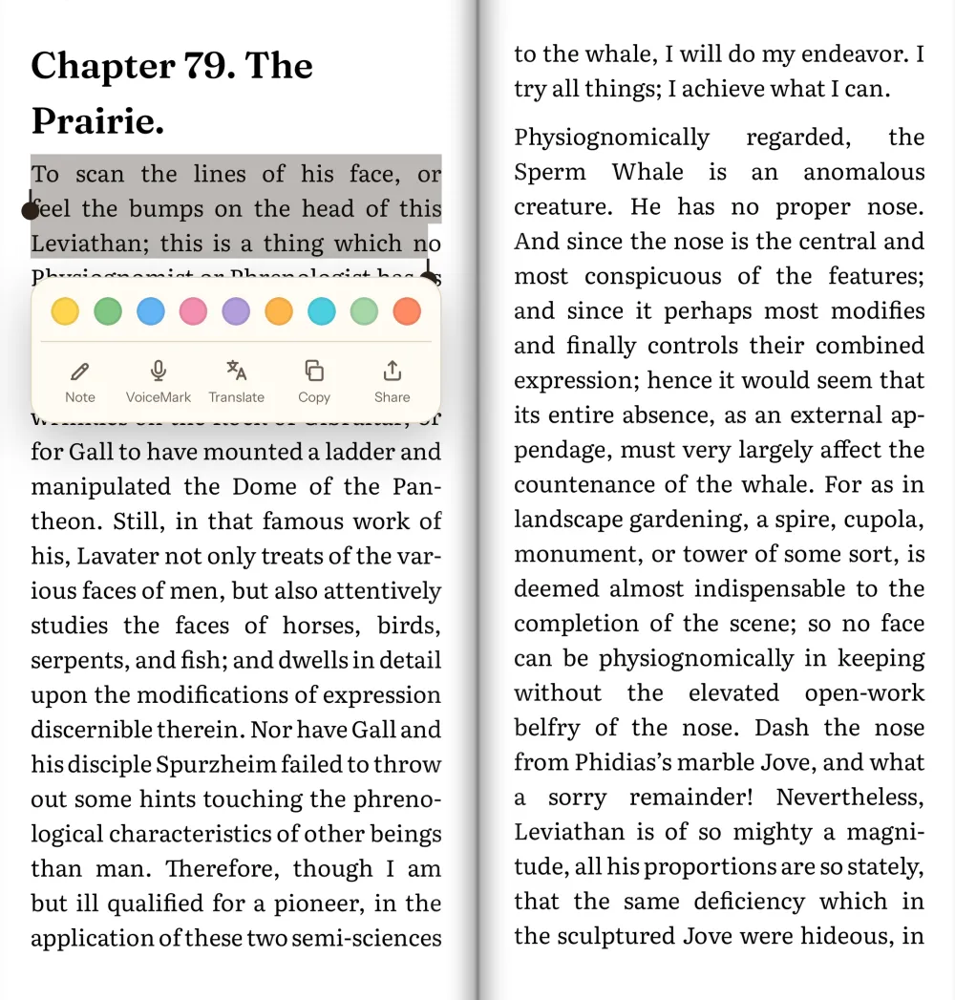
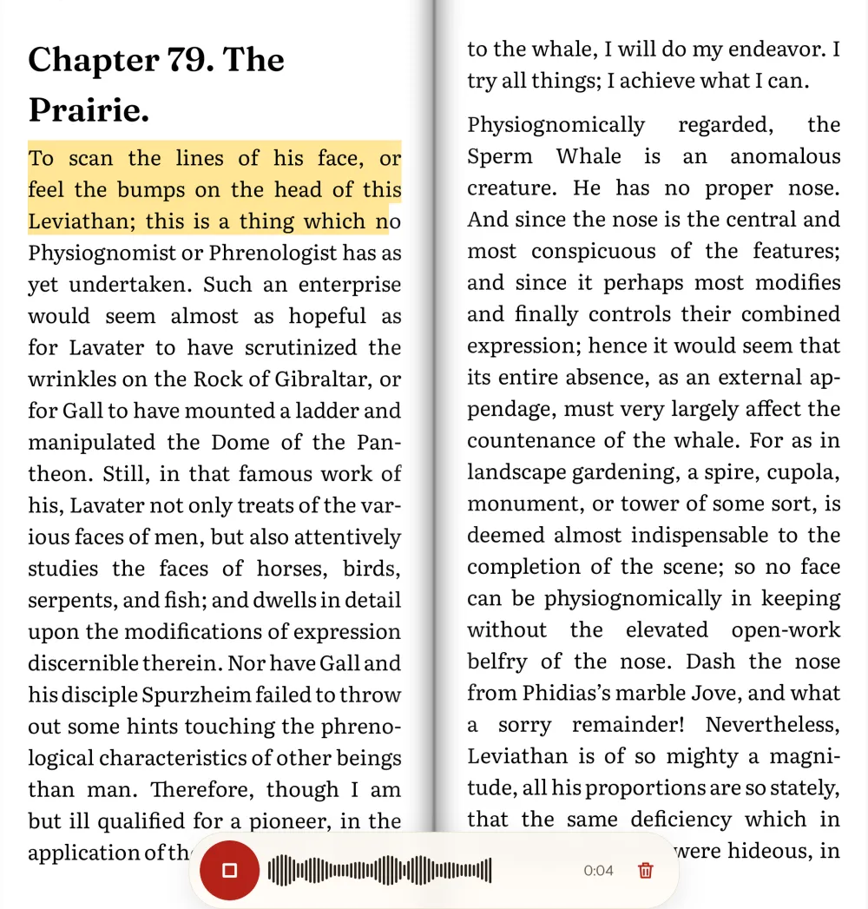
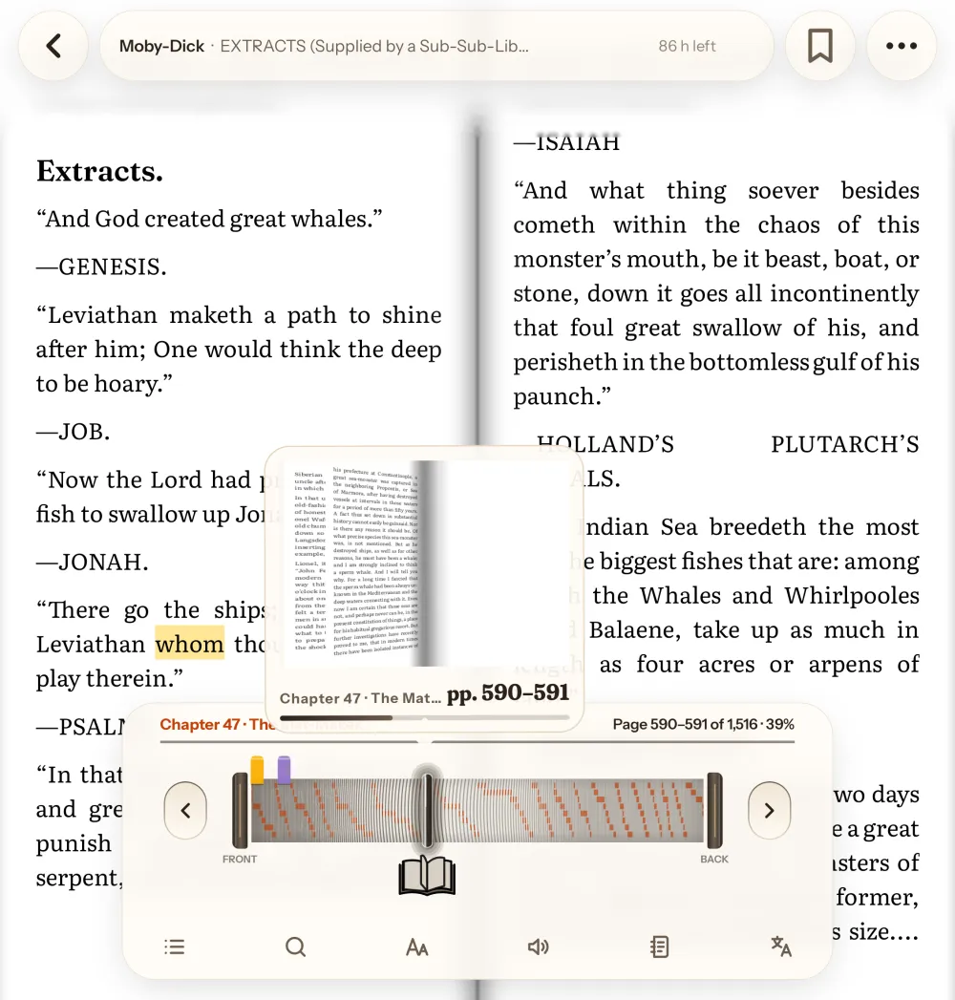
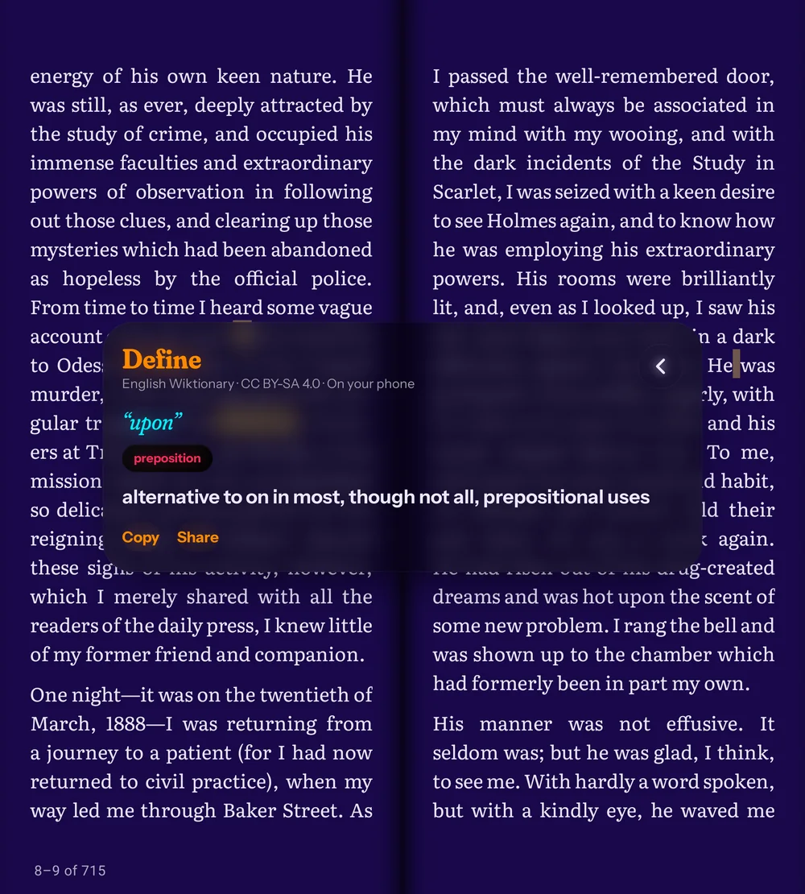
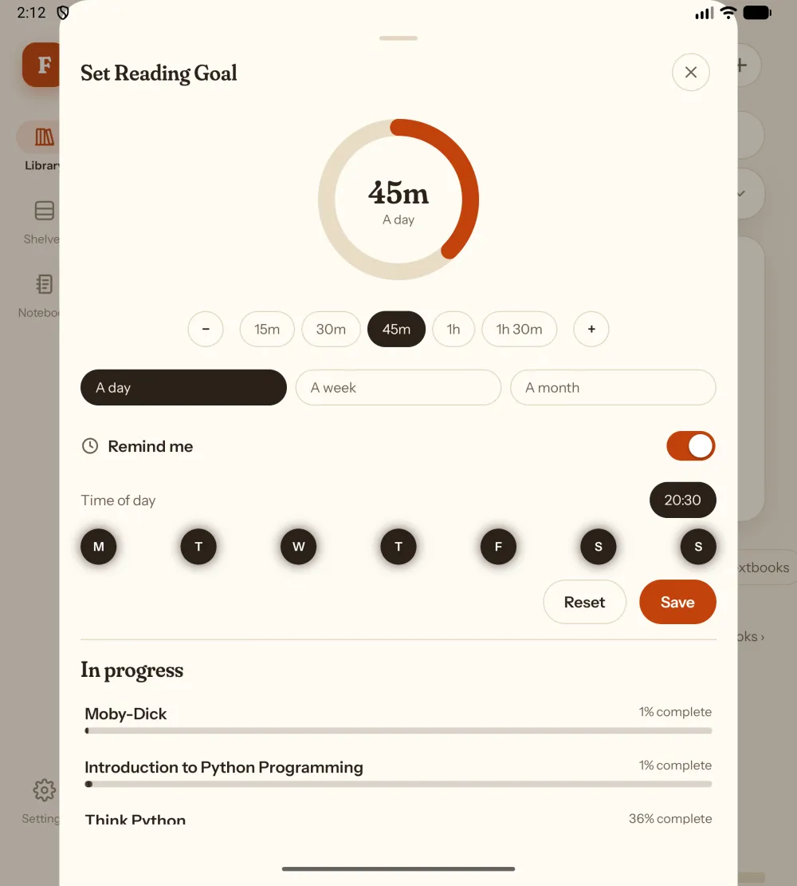

<div align="center">

# FlowFolio

**A reader that treats a book like a book.**

An open-source Android reader for textbooks and ebooks — with a physics-based page curl, a converter
that reflows fixed-layout PDFs on your phone, and a reading atmosphere you set once and keep.

Built foldable-first: one page folded, a two-page spread unfolded.

[](#)
[](#)
[](#)
[](LICENSE)
[](#privacy)



<br><br>





</div>

---

## Why another reader

Most readers treat a PDF as a picture of a page and an EPUB as a web page. FlowFolio does neither.
It knows the difference between **a page you look at** and **text you read**, and it will turn the
first into the second — on the phone, with nothing leaving it.

| | |
|---|---|
| 📖 **Pages that turn** | A real 3D curl, two at a time unfolded. Slide and scroll are there if you prefer. |
| 🔄 **Dynamic Flow** | A textbook PDF whose type is too small reflows to fit your screen. Figures, tables, equations, footnotes and page numbers all survive. The original stays exactly as it is. |
| 🎚️ **Riffle through it** | Drag the book on the bottom bar to flick pages, with chapters and your ribbons marked along the edge. Hold it to drop a detour mark and come straight back. |
| ✍️ **Mark it up** | Nine highlight colours, notes, ribbons, and **VoiceMark** — say what you were thinking instead of typing it. |
| 🔊 **Narrator Mode** | Offline neural voices (Kokoro and Piper via `sherpa-onnx`) that read aloud with natural pauses, turn pages automatically, and work without a connection after a one-time voice download. |
| 📚 **Words, search and languages** | In-book phrase search across PDF and Dynamic Flow views, a bundled English dictionary (Wiktionary + WordNet 3.1 + Wikipedia), and on-device translation. |
| 🌧️ **Reading Atmosphere** | Page and sound together: rain, a fire, a quiet café, a file of your own, or any stream address. |
| 🎯 **A reading habit** | Goals by day, week or month, with the days that count and when to be reminded. |
| 🎨 **Yours** | Four themes including true black, seven reading fonts or the book's own, page colours, margins, turn styles and sounds. |

---

## See it

<div align="center">

| Dynamic Flow | Marking up | VoiceMark |
|:---:|:---:|:---:|
|  |  |  |
| A PDF reflowed on your phone, the original kept | Nine colours, notes, share, copy | A spoken note, kept with the passage |

| Riffle bar | Dictionary | Reading goal |
|:---:|:---:|:---:|
|  |  |  |
| Flick through with chapters marked | Wiktionary, entirely offline | A day, a week or a month |

</div>

---

## Privacy

FlowFolio has **no accounts, no analytics and no trackers.** Your library never leaves the phone.

Three things reach the network, each off or on demand, and none of them identifies you:

| What | When | What is sent |
|---|---|---|
| Book details | Only if you turn on "Look up book details online" | An ISBN, or a title and author |
| Translation models | The first time you translate into a language | Which language model to download (~30 MB), by Google ML Kit |
| Updates & stream audio | When you check for updates, or play a stream address you typed | A request to the releases page, or to the address you gave |

Everything else — reading, reflowing a PDF, the dictionary, highlights, VoiceMarks — happens on the
device. The dictionary is bundled; conversion runs on your phone, not a server.

---

## Install

FlowFolio is distributed on **GitHub Releases** and (soon) **F-Droid** — never the Play Store.

1. Download the `.apk` from [Releases](https://github.com/mgmourad/FlowFolio/releases/latest).
2. Check the `.sha256` beside it if you like: `shasum -a 256 flowfolio-*.apk`.
3. Open it; Android will ask before installing.

Once installed, **Settings → Updates** checks for newer builds and can fetch them for you. Android
still asks before it installs anything — no app can install silently, and FlowFolio does not try to.

**Requires Android 10 (API 29) or newer.**

---

## Build it yourself

Prerequisites: JDK 21, Android SDK (API 37), and a Python 3 on `PATH` (the build embeds yt-dlp).

```bash
git clone https://github.com/mgmourad/FlowFolio.git && cd FlowFolio/android
./gradlew assembleDebug
```

The APK lands in `app/build/outputs/apk/debug/`.

```bash
./gradlew testDebugUnitTest                 # JVM and Robolectric tests
./gradlew spotlessCheck detekt lintDebug    # formatting, static analysis, Android lint
```

---

## How it is put together

| Path | What |
|---|---|
| `android/app` | The single activity, navigation and app shell |
| `android/core/reflow`, `core/epub` | The EPUB pagination engine and parser (ADR-0019, ADR-0020) |
| `android/core/pdf` | PDFium through our own JNI bridge (ADR-0010) |
| `android/core/voice` | Offline neural TTS (Kokoro & Piper on `sherpa-onnx`, ADR-0051) |
| `android/core/conversion` | PDF → EPUB, a plain JVM module that runs on the phone (ADR-0044) |
| `android/core/extract` | yt-dlp on an embedded Python, for stream audio (ADR-0048) |
| `android/core/designsystem` | Every token, effect, component and glyph |
| `android/feature/reader`, `feature/library` | The reader (curl, riffle, annotations) and the library |
| `docs/adr` | Every decision, with its alternatives and consequences |
| `docs/conversion-spec.md` | The converter's output contract |

Kotlin 2.4, Jetpack Compose with Material 3, Hilt, Room, single activity, MVVM. No GPL code
anywhere, because everything ships inside the app ([licence matrix](docs/licenses.md)).

---

## Contributing

Issues and pull requests are welcome — [CONTRIBUTING.md](CONTRIBUTING.md) has the build, the checks CI will run,
and how decisions get recorded. Security reports go [here](SECURITY.md) instead, privately.

A good place to start reading is [`docs/adr/`](docs/adr): every significant decision, with the alternatives that
lost and the consequences accepted.

## Licence

[MIT](LICENSE). PDFium, Fraunces, Instrument Sans, JetBrains Mono, yt-dlp and the bundled Wiktionary
data keep their own licences — all of them permissive, all listed in
[docs/licenses.md](docs/licenses.md).
