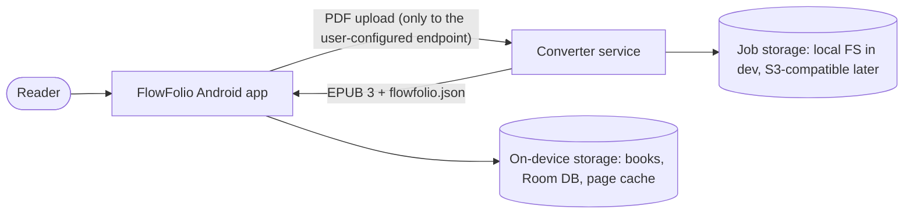

# FlowFolio Architecture

Status: Phase 0 (skeletons only). Sections marked *planned* describe intent, not code.

## System context

Privacy: reading is offline by default. Files leave the device only when the user converts a
book, and only to the converter endpoint they configured (self-hosted or chosen by them).

## Containers

### Android app (`android/`)
- Kotlin, Jetpack Compose, Material 3, single activity, Hilt (ADR-0007), minSdk 29 (ADR-0006).
- MVVM with unidirectional data flow: Compose UI renders a `UiState` from a `ViewModel`; user
  actions are events into the ViewModel; the ViewModel calls `domain` use cases that depend on
  `data` repositories (interfaces in `domain`, implementations in `data`).
- *Planned modules* (ADR-0005): `:core:model`, `:core:data`, `:core:designsystem`, `:core:pdf`,
  `:core:epub`, `:feature:library`, `:feature:reader`, `:feature:conversion`.
- *Planned* rendering: PDF renderer chosen by the Phase 1 spike; reflow pagination engine chosen by
  the Phase 2 spike; page curl based on `oleksandrbalan/pagecurl` (vendored if needed); bounded LRU
  bitmap cache with adjacent-page prefetch.

### Converter (`converter/`)
- Python 3.13, FastAPI, Pydantic v2, uv (ADR-0004), Docker; CPU-correct, GPU optional.
- Phase 0: `GET /healthz`, `GET /version`, a CLI entry point (`flowfolio-convert`).
- *Planned* pipeline of independently runnable stages over a typed `Document` IR:

Each stage reads and writes the IR (serializable to JSON for debugging), so
`flowfolio-convert stage <name> --in ir.json --out ir2.json` can run any stage alone.

- *Planned* job API: `POST /jobs` (upload) → `GET /jobs/{id}` (status, progress, finished chapters)
  → `GET /jobs/{id}/bundle`. Server-sent events for progress.

## Shared contract
`docs/conversion-spec.md` and (from Phase 3) `docs/schemas/flowfolio.schema.json`.

## Quality
- Golden corpus manifest in `samples/corpus/manifest.yaml`; PDFs fetched by script, never committed.
- Metrics per run stored in `samples/golden/` baselines; CI fails on regression beyond tolerance (Phase 3+).
