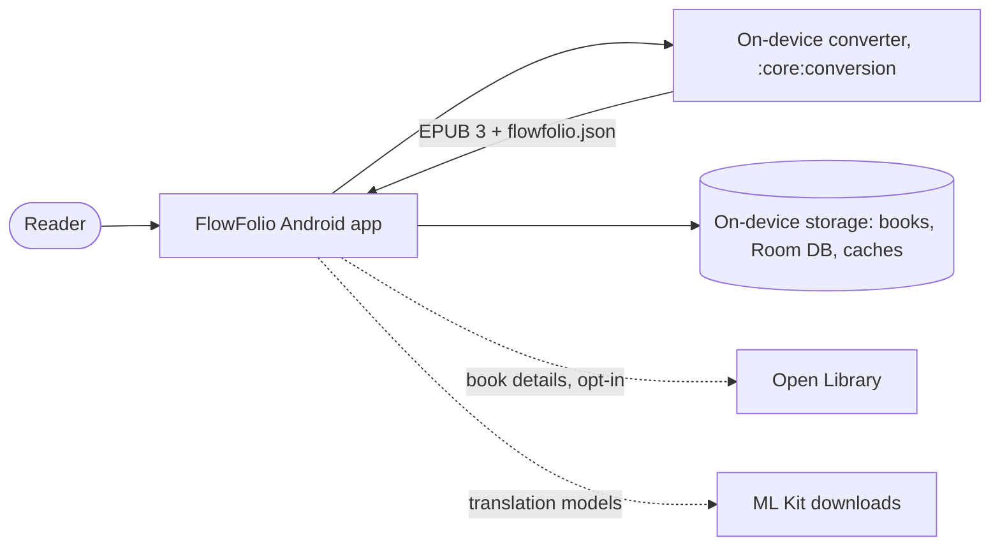
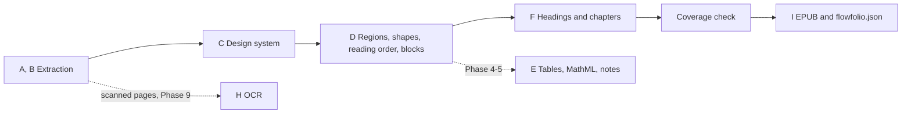

# FlowFolio Architecture

Status: Phase 3 (2026-10-27). Sections marked *planned* describe intent, not code. Module detail: `CLAUDE.md`.

## System context

Privacy: books never leave the device. Conversion runs on the phone (ADR-0009); the only network use is the opt-in
book details lookup and ML Kit translation (model downloads and anonymous usage data; ADR-0017, ADR-0018).

## The app (`android/`)

- Kotlin, Jetpack Compose, Material 3, single activity, Hilt (ADR-0007), minSdk 29 (ADR-0006), MVVM with
  unidirectional data flow.
- Reading: PDFium through our own JNI bridge (`:core:pdf`, ADR-0010), the vendored page curl (`:core:pagecurl`,
  ADR-0011), our EPUB parser and pagination engine (`:core:epub`, `:core:reflow`, ADR-0019/0020), the reader
  (`:feature:reader`), library and shelves (`:feature:library`).

## The converter (`:core:conversion`, ADR-0009, ADR-0044)

A plain Kotlin/JVM module the app calls directly. It reads a PDF through the `PdfSource` interface: on the phone
`PdfiumConversionSource` (`:core:pdf`, JNI, WebP images); on the desktop `JnaPdfSource` (`android/tools/convert`, JNA
and PDFium's own builds, PNG images, development and tests only). Stages run over a typed `Document` IR:

`tools/convert` runs any book or page through the stages (`convert`, `page`, `probe`, `unmatched`, `render`).
*Planned (M3):* a WorkManager foreground job in its own process, resumable, with a progress notification.

## Shared contract

`docs/conversion-spec.md` (v1.0.0, normative) and `docs/schemas/flowfolio.schema.json`.

## Quality

- The corpus: `samples/corpus/manifest.yaml`, fetched by `tools/corpus/fetch_corpus.py` and checked by SHA-256; never
  committed.
- `CorpusTest` converts every corpus book on the JVM, runs EPUBCheck, checks the sidecar against the schema and the
  metrics against `samples/golden/baselines/` (with 30 hand-labelled pages). *Planned (M3):* the same gate in CI.
